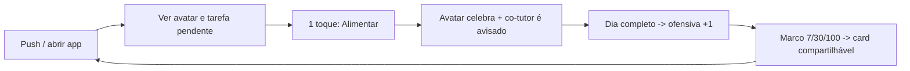
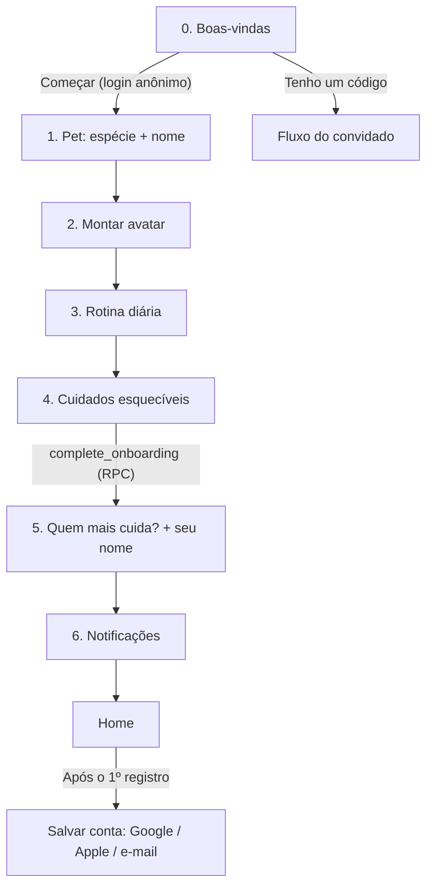
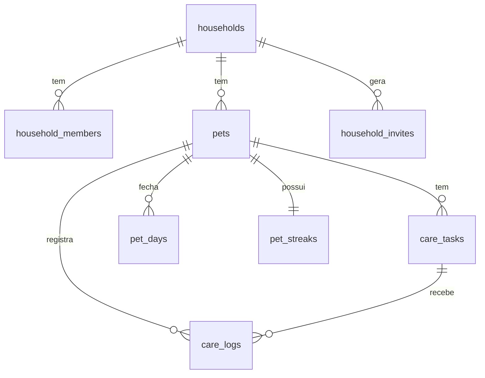

# Lumin (nome provisório): Especificação do MVP v2

> Este documento substitui a proposta v1 ("Duolingo da alimentação").
> Banco de dados: [`supabase/migrations/20261116000000_init.sql`](../supabase/migrations/20261116000000_init.sql)

---

## 0. O que mudou em relação à v1

| v1 | v2 | Motivo |
|---|---|---|
| Ofensiva de alimentação | Ofensiva **da família** + cuidados que costumam ser esquecidos | Ninguém esquece de alimentar o cachorro. A dor real é a coordenação e os cuidados de baixa frequência. |
| Login no passo 1 | Login **anônimo** silencioso e conta vinculada depois da 1ª vitória | O usuário vê valor antes de passar pelo cadastro |
| IA de visão para o avatar | Montador manual com 6 traços + botão "Aleatório" | Custo, latência e falhas. A IA fica para a v1.2. |
| FastAPI + Supabase | **Só Supabase** (RLS, RPC, Realtime, Edge Functions, pg_cron) | Um backend a menos. A FastAPI volta com IA/IoT. |
| Sem convite | Convite do co-tutor **dentro** do onboarding | Principal loop viral |
| Lembretes locais | Lembretes **pelo servidor**, que conhecem o estado da família | Um lembrete local dispararia mesmo se o parceiro já tivesse feito a tarefa |
| Sem métricas | Analytics no primeiro dia + metas para decidir se o produto continua | Decisões com dados |

---

## 1. Proposta de valor

**"O Paçoca nunca fica sem um cuidado, e a família inteira sabe quem fez o quê."**

- **Público inicial:** casais e famílias (2 a 4 pessoas) que dividem 1 cão ou gato, de 22 a 40 anos, no Brasil.
- **Diferenciais:** sincronização em tempo real ("Ana já alimentou às 08:02"), lembrete de antipulgas, vermífugo e remédio, e um avatar que reflete o estado do pet.
- **Referência de produto:** Finch (pet virtual + autocuidado). O tom de voz segue o Duolingo.

---

## 2. Escopo do MVP

| ✅ Dentro | ❌ Fora (pós-validação) |
|---|---|
| 1 pet por família, cão ou gato | Múltiplos pets |
| Avatar montado manualmente (SVG em camadas) | IA de visão |
| Tarefas diárias: alimentar, passear | Feed social |
| Tarefas por intervalo: antipulgas, vermífugo, remédio | IoT (ESP32/BLE) |
| Ofensiva da família + congelamento automático | Loja de cosméticos / moeda "Petiscos" (Sprint 5) |
| Convite do co-tutor por código/link | Modo "pet sitter" (o schema já suporta) |
| Pushes de co-tutor e de atraso | Histórico de saúde / relatório para o veterinário |
| Card de ofensiva compartilhável | Premium / pagamentos |

---

## 3. Core loop e regras do jogo



### 3.1 Dia completo e ofensiva
- **Dia completo:** todos os horários das tarefas **diárias** ativas foram registrados, com a data calculada **no fuso do pet**.
- **Ofensiva:** dias completos seguidos, que pertencem ao **pet** (à família, não a uma pessoa).
- **Congelamento:** a família começa com 1 congelamento (máximo 3). Um buraco de exatamente 1 dia consome um congelamento automaticamente quando o dia seguinte é completado.
- **Tarefas por intervalo** (antipulgas etc.) **não quebram a ofensiva**. Quando atrasadas, deixam o avatar `worried` e disparam push. Assim a família não é punida por algo que só acontece uma vez por mês.

### 3.2 Humor do avatar (calculado no cliente, função pura)
Prioridade, da primeira à última:

| Estado | Condição |
|---|---|
| `celebrating` | Registro feito nos últimos 5 s |
| `hungry` | Horário de alimentação atrasado mais de 30 min |
| `worried` | Tarefa de intervalo vencida |
| `bored` | Passeio atrasado mais de 60 min |
| `sleepy` | Entre 22h e 6h no fuso do pet, sem pendências |
| `happy` | Padrão |

O humor **não é salvo** no banco: ele é derivado do estado. Quando chegar o IoT, o evento só altera o estado, e o humor muda sozinho.

---

## 4. Onboarding

### 4.1 Fluxo do novo tutor



A barra de progresso cobre os passos 1 a 6 (a tela de boas-vindas fica fora dela). O pet é **salvo no fim do passo 4**, então quem abandonar depois disso não perde nada.

### 4.2 Telas

**🧠 UX (texto) · 🖐️ Usabilidade (interação)**

| # | Título (texto) | Elementos | CTA (rodapé) | Regra de fricção |
|---|---|---|---|---|
| 0 | "Todo pet merece uma família organizada 🐾" | Avatar genérico acenando | **Começar** · link "Tenho um código de convite" | `signInAnonymously()` acontece em segundo plano ao tocar |
| 1 | "Quem é o dono do seu coração?" | 2 cards grandes (🐶 Cachorro / 🐱 Gato) + campo "Nome do pet" | **Continuar** | Teclado abre só depois de escolher a espécie. CTA habilitado com nome ≥ 1 caractere. |
| 2 | "Vamos desenhar o {nome}!" | Preview grande + 6 traços em carrossel (cor, padrão, cor do padrão, orelhas, focinho, olhos) + 🎲 Aleatório | **É o {nome}!** | Já abre com uma combinação aleatória, então o CTA fica sempre habilitado |
| 3 | "Qual a rotina do {nome}?" | Refeições: chips `2x (08h/19h)` · `3x` · `Personalizar`. Passeio: `Não` · `1x` · `2x` | **Continuar** | Presets pré-selecionados (cão: 2x + 2 passeios; gato: 2x + nenhum passeio) |
| 4 | "Os cuidados que todo mundo esquece 😅" | Multisseleção: Antipulgas · Vermífugo · Remédio contínuo. Para cada um: "Quando foi o último?" `Este mês` · `Faz mais tempo` · `Não lembro` | **Continuar** · "Pular" | "Não lembro" ou "Faz mais tempo" agenda o próximo para hoje e gera a 1ª vitória rápida |
| 5 | "Quem mais cuida do {nome}?" | Campo "Como o {nome} te chama?" (ex: Mãe, Ana) + botão **Convidar pelo WhatsApp** + código visível | **Continuar** · "Cuido sozinho(a) por enquanto" | O nome vem preenchido. O convite abre o `share_plus` com uma mensagem pronta. |
| 6 | "Quer que eu te avise se o {nome} ficar com fome?" | Ilustração do avatar com balão | **Sim, me avise!** → prompt do sistema · "Agora não" | Explicação antes do prompt do sistema. Quem recusa recebe um novo pedido após o 3º registro. |

**Home pós-onboarding:** a 1ª tarefa pendente fica em destaque, junto com o tooltip *"Toque aqui quando der comida ao {nome}"*.

**Salvar conta** (bottom sheet depois da 1ª celebração): *"Salve o progresso do {nome} para não perder nada se trocar de celular."* Usa `linkIdentity` (Google / Apple) ou e-mail com OTP. Depois disso, aparece como um banner que pode ser fechado, até 3 vezes.

### 4.3 Fluxo do convidado
Boas-vindas → "Tenho um código" → código (6 caracteres, preenchido automaticamente se veio pelo link) → "Como o {pet} te chama?" → revelação: *"Você agora cuida do Paçoca junto com a Ana! 🎉"* → Notificações → Home.

### 4.4 Regras de navegação (🖐️)
- `PageView` com `NeverScrollableScrollPhysics`, avançando só pelo CTA.
- "Voltar" no topo a partir do passo 2, preservando o rascunho.
- CTA principal com `height: 56`, largura total, margem de 20 e sempre acima do teclado (`viewInsets`).
- O rascunho é salvo localmente a cada passo, e reabrir o app retoma do passo atual.

---

## 5. Notificações (🧠 texto · regras no servidor)

**Regras:** no máximo 3 pushes de lembrete por usuário por dia, silêncio entre 22h e 7h (fuso do pet) e nunca lembrar algo que outro membro já fez.

| Gatilho | Para quem | Texto |
|---|---|---|
| Co-tutor registrou | Outros membros | "🍖 Ana alimentou o Paçoca às 08:02. Pode ficar tranquilo(a)!" |
| Refeição atrasada 30 min | Todos os membros | "O Paçoca está olhando pro pote... e pra você. 🥺" |
| Refeição atrasada 90 min | Todos os membros | "Alguém alimentou o Paçoca? Ninguém marcou ainda!" |
| Ofensiva em risco (20h) | Todos os membros | "🔥 A ofensiva de 12 dias do Paçoca acaba à meia-noite!" |
| Intervalo vence hoje | Todos os membros | "Dia de antipulgas! O Paçoca agradece (mesmo reclamando) 🐜🚫" |
| Marco de 7/30/100 dias | Todos os membros | "🏆 30 dias sem faltar nada! Mostra pro mundo?" (abre o card) |

**Implementação:** um Database Webhook em `care_logs` dispara a Edge Function `notify-cotutors`, e um `pg_cron` a cada 10 min chama a Edge Function `reminders`. O envio usa FCM (Android + APNs).

---

## 6. Arquitetura (🏗️ Arquiteto)

### 6.1 Stack
- **Flutter** (estável mais recente), **Riverpod 3** (`Notifier`/`AsyncNotifier`), **go_router**, **freezed** + **json_serializable**.
- **supabase_flutter** (Auth anônima + linkIdentity, RPC, Realtime).
- **flutter_svg** + **vector_graphics** (SVGs pré-compilados em `.vec`).
- **firebase_messaging**, **flutter_timezone**, **share_plus**, **shared_preferences**, **uuid**, **posthog_flutter**, **sign_in_with_apple**, **google_sign_in**.

### 6.2 Estrutura de pastas

```text
lumin/
├── docs/SPEC_MVP.md
├── supabase/
│   ├── migrations/20261116000000_init.sql
│   └── functions/
│       ├── notify-cotutors/          # webhook care_logs -> FCM
│       └── reminders/                # pg_cron -> atrasos, ofensiva em risco, intervalos
└── app/
    ├── assets/avatar/{dog,cat}/{body,pattern,ears,snout,eyes,expression,accessory}/*.svg
    ├── test/                         # espelha lib/
    └── lib/
        ├── main.dart
        ├── app/
        │   ├── bootstrap.dart        # init Supabase, Firebase, PostHog
        │   ├── app.dart              # MaterialApp.router
        │   └── router.dart           # redirect: sem sessão/sem pet -> onboarding
        ├── core/
        │   ├── env/env.dart          # --dart-define (SUPABASE_URL, ANON_KEY...)
        │   ├── error/failure.dart    # sealed class Failure
        │   ├── clock/clock.dart      # Clock injetável (testes de fuso/meia-noite)
        │   ├── analytics/            # interface Analytics + impl PostHog
        │   ├── supabase/supabase_providers.dart
        │   ├── theme/
        │   └── widgets/              # PrimaryCta, StepProgressBar
        └── features/
            ├── avatar/
            │   ├── domain/           # AvatarDna, AvatarMood, MoodResolver (Dart puro)
            │   └── presentation/     # AvatarView (Stack + RepaintBoundary), AvatarBuilder
            ├── onboarding/
            │   ├── domain/           # OnboardingDraft, RoutinePreset, CompleteOnboarding
            │   ├── data/             # repo impl (RPC), DraftLocalStore
            │   └── presentation/     # OnboardingController, OnboardingPage, steps/step_*.dart
            ├── care/
            │   ├── domain/           # CareTask, CareLog, Streak, LogCare, UndoCare, NextSlotResolver
            │   ├── data/             # RPC + Realtime, PendingLogQueue (offline)
            │   └── presentation/     # HomePage, CareController, TaskActionBar, TodayTimeline
            ├── household/            # convite, entrar por código, membros
            ├── account/              # vincular Google/Apple/e-mail
            └── notifications/        # token FCM, pre-prompt, deep link do push
```

### 6.3 Regras de camadas
- `domain/` é **Dart puro**: sem Flutter, sem Supabase. Testável em milissegundos.
- `presentation/` depende de `domain/` por meio de providers. Nunca importa `data/` diretamente.
- O estado de UI efêmero (`PageController`, `TextEditingController`, `AnimationController`) **fica no widget**. O Notifier expõe só dados (`currentStep`, `draft`, `status`).

### 6.4 Registro de cuidado (otimista + offline)
1. O toque gera `logId = uuid v4` e atualiza a UI na hora (estado otimista + celebração).
2. O registro entra na `PendingLogQueue` (persistida) e chama `rpc('log_care')`.
3. A resposta pode ser:
   - `created`: confirma.
   - `already_done`: reverte o otimismo e mostra *"Ana já tinha alimentado às 08:02 💛"*.
   - Erro de rede: fica na fila com um ícone discreto de "pendente". A fila é reenviada ao reconectar, usando o mesmo `logId` (idempotente).
4. O `occurred_at` é o momento do toque. O servidor aceita até 48 h de atraso.
5. Snackbar "Desfazer" por 5 s chama `rpc('undo_care')`.

### 6.5 Renderização do avatar
- `Stack` com até 7 camadas `SvgPicture` de assets **pré-compilados** (`vector_graphics_compiler`).
- As cores são aplicadas com `ColorFilter` sobre camadas monocromáticas, o que dispensa um SVG por cor.
- Camadas estáticas (corpo → acessório) ficam em um `RepaintBoundary`. A camada `expression` fica em outro, porque é a única que muda com o humor.
- `AvatarDna` é versionado (`"v": 1`) para migrar traços no futuro.

```json
{ "v": 1, "species": "dog", "base_color": "#C8853F", "pattern": "spots",
  "pattern_color": "#FFFFFF", "ears": "floppy", "snout": "short",
  "eyes": "round", "accessory": null }
```

---

## 7. Modelo de dados

Detalhes no SQL da migration. Resumo:



| RPC | Uso |
|---|---|
| `complete_onboarding(jsonb)` | Cria household + owner + pet + tarefas de forma atômica e idempotente |
| `log_care(log_id, task_id, slot_index, occurred_at)` | Registra o cuidado. Retorna `created` / `already_done` + ofensiva |
| `undo_care(log_id)` | Desfaz um registro próprio em até 10 min |
| `create_invite(household, role, sitter_days)` | Código de 6 caracteres válido por 7 dias, até 5 usos |
| `join_household(code, display_name)` | Entra na família |
| `pet_streak(pet_id)` | Ofensiva atual |

---

## 8. Edge cases (🐛 QA) e como estão resolvidos

| Caso | Solução |
|---|---|
| Dois tutores tocam "Alimentar" ao mesmo tempo | `UNIQUE(task_id, slot_date, slot_index)` + `on conflict do nothing`. O segundo recebe `already_done` com o nome de quem fez. |
| Os dois completam os últimos horários do dia ao mesmo tempo | `SELECT ... FOR UPDATE` no pet serializa, e o 2º recálculo enxerga o insert do 1º |
| Usuário viaja e muda de fuso | O dia é calculado no `pets.timezone`, não no celular. Mudar o fuso do pet fica nas configurações, com aviso. |
| Registro offline que só sincroniza no dia seguinte | O `occurred_at` original define o dia, então o dia de ontem é fechado corretamente (até 48 h) |
| Fila offline reenviada várias vezes | O `log_id` gerado no cliente é a PK, então o retry é idempotente |
| Toque acidental | Desfazer em 5 s na UI (o servidor permite até 10 min) e o dia/ofensiva é recalculado |
| Abandono no meio do onboarding | Rascunho local por passo. O pet é salvo atomicamente no passo 4 e o router manda para a Home se o pet existir. |
| Usuário anônimo desinstala o app | Os dados se perdem. O lembrete para salvar a conta aparece após a 1ª vitória e o risco é dito com clareza. |
| `linkIdentity` com um Google que já tem conta | Erro tratado: o app oferece "Entrar nessa conta". A mesclagem de dados fica fora do MVP e o aviso é explícito. |
| Força bruta em códigos de convite | ~10⁹ combinações, expiração de 7 dias e limite de usos. **Pendente:** rate limit por usuário (Edge Function ou tabela de tentativas) antes do lançamento público. |
| Convidado sem o app instalado (deep link adiado) | O código fica visível na mensagem do WhatsApp e é digitado manualmente. Um deep link adiado (Branch ou similar) entra só se a métrica de convite mostrar perda. |
| Lembrete dispara depois que o parceiro já fez | Os lembretes são gerados no servidor, que verifica `care_logs` antes de enviar |
| Tarefa editada no meio do dia (de 2x para 3x) | `refresh_pet_day` usa as tarefas ativas atuais. Aceito no MVP: editar pode "descompletar" o dia de hoje. A UI avisa. |
| Sitter com acesso expirado | `is_member` checa `expires_at`. O sitter perde a leitura automaticamente. |

---

## 9. Métricas e analytics (📈 Growth)

### 9.1 Eventos obrigatórios
`onboarding_step_viewed{step}` · `onboarding_step_completed{step, preset}` · `onboarding_completed` · `avatar_randomized` · `invite_shared{channel}` · `invite_joined` · `push_permission{granted}` · `care_logged{type, source: tap|push, latency_from_open_ms}` · `care_already_done` · `care_undone` · `day_completed{streak}` · `streak_broken{length}` · `streak_card_shared{milestone}` · `account_linked{provider}`

### 9.2 Metas para decidir se o produto continua (beta com 20 a 50 famílias)

| Métrica | Meta | Se não bater |
|---|---|---|
| Conclusão do onboarding | > 60% | Cortar ou fundir passos (o 4 é o candidato) |
| Famílias com 2+ membros em 7 dias | > 30% | Rever o texto e o incentivo do convite |
| Tempo entre abrir o app e registrar | < 5 s (mediana) | Rever a Home |
| Retenção D1 / D7 / D30 | 40% / 20% / 10% | Rever o core loop antes de qualquer marketing |
| Retenção de famílias 2+ vs. solo | ≥ 2x | Se não for, a tese de co-tutoria cai e é hora de pivotar |

---

## 10. Loops de crescimento no MVP
1. **Convite do co-tutor** no passo 5 + lembrete na Home: *"O Paçoca tem só 1 tutor no app 😢"*.
2. **Card de ofensiva** (formato Stories 9:16) nos marcos de 7, 30 e 100 dias, com o avatar, o número de dias e um QR code/link.
3. **Mensagem de convite pronta para o WhatsApp:** *"Agora a gente cuida do Paçoca junto pelo Lumin 🐾 Baixa aqui: {link} e usa o código {ABC123}"*.

---

## 11. Roadmap

| Sprint (1–2 sem) | Entregas | Pronto quando |
|---|---|---|
| **S0: Fundação** | Instalar Flutter, criar o projeto `app/`, configurar o projeto Supabase + migration, tema, `StepProgressBar`, `PrimaryCta`, assets do avatar (2 espécies × traços mínimos), CI (analyze + test) | `flutter test` verde no CI e migration aplicada |
| **S1: Onboarding** | Telas 0 a 6, login anônimo, `complete_onboarding`, rascunho local, fluxo do convidado | Do zero até a Home em < 90 s em um aparelho médio |
| **S2: Core loop** | Home, `log_care`, otimismo, fila offline, desfazer, Realtime, `MoodResolver`, ofensiva | Dois celulares sincronizados em < 2 s e todos os testes de QA da seção 8 passando |
| **S3: Social + Push** | Convites, Edge Functions (`notify-cotutors`, `reminders`), FCM/APNs, vincular conta | Push de co-tutor chegando, lembrete suprimido quando o parceiro já fez |
| **S4: Beta** | Analytics, card compartilhável, polimento e animações, TestFlight + Play Internal com 20 a 50 famílias | Painel de métricas da seção 9 ativo |
| **S5: Pós-validação** | Moeda "Petiscos" + loja de cosméticos e congelamentos, modo sitter, cupons de parceiros | Só começa se a seção 9.2 for atingida |

> **Em paralelo à S0 e S1:** fazer as 20 entrevistas da Fase 0 e montar a landing page com lista de espera para recrutar o beta.

---

## 12. Revisão do Tech Lead (⚖️)

**Veredito: APROVADO para iniciar a S0.**

**Pontos fortes:**
- As regras de domínio críticas (dia, ofensiva, concorrência, idempotência) estão **no servidor e testáveis em SQL**. O cliente não consegue trapacear a ofensiva.
- RLS em todas as tabelas, escrita sensível só via RPC e `GRANT` por coluna (impede que um membro vire owner).
- Domínio Flutter em Dart puro, com UI efêmera fora do Riverpod e `Clock` injetável.

**Pendências obrigatórias antes do beta público:**
1. Rate limit em `join_household`.
2. Testes de SQL (pgTAP ou script) para: concorrência em `log_care`, congelamento, virada de meia-noite em `America/Sao_Paulo` vs. `Asia/Tokyo` e `undo_care` em tarefa de intervalo.
3. Testes unitários do `MoodResolver` e do `NextSlotResolver` com `Clock` falso.
4. Medir a memória do `AvatarView` no DevTools: meta de < 15 MB de incremento e 60 fps no carrossel do montador.
5. Ativar no Supabase: **Anonymous Sign-ins**, **Manual Linking** e CAPTCHA no login anônimo (exigência anti-abuso do próprio Supabase).

**Riscos que continuam abertos:**
- **Produção dos assets do avatar** é o gargalo real (precisa de um ilustrador). Começar com poucos traços e bem-feitos.
- **Push no iOS** exige conta Apple Developer (US\$ 99/ano) e certificado APNs.
- **A tese de co-tutoria ainda não foi validada.** As métricas da seção 9.2 decidem o futuro, não a opinião do time.

**Definition of Done (para todo PR):** `flutter analyze` sem warnings · testes do domínio passando · nenhum import de `data/` em `presentation/` · nenhum `PageController`/`TextEditingController` em Notifier · evento de analytics instrumentado quando houver uma ação nova do usuário.
